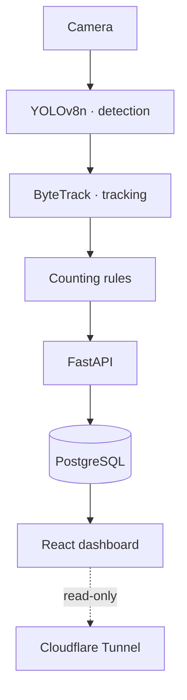

## Problem

Church leadership wanted to know how many people attended each service and how occupancy changed over
time, to plan space, volunteers and schedules. Manual counting was inaccurate, depended on a volunteer
and left no history.

## Solution

A camera at the entrance feeds a Python pipeline that detects people with **YOLOv8n** and follows them
across frames with **ByteTrack**. Each person becomes a _track_ with an identity; counting happens when a
track crosses the entry or exit line — not when someone shows up in a frame.

Events go to **PostgreSQL** through a **FastAPI** service, and a **React + Vite + Recharts** dashboard
shows live occupancy and per-service history.

Everything runs **on-premise**, on a computer at the church, as a `systemd` service. For remote viewing, a
**Cloudflare Tunnel** exposes only the read-only dashboard — no open router ports, no footage leaving the
building and no monthly cloud bill.

## Result

- Live occupancy and per-service attendance on a dashboard, no manual counting
- History to compare services, months and time slots
- Fully on-premise: footage stays private and cloud cost is zero
- [TODO: accuracy measured against manual counts, e.g. "X% error across N services"]

## Impact

[TODO: a decision leadership made based on the data — e.g. schedule change, greeting team size]

## Technical challenges

### Occupancy is not attendance

They're different metrics, and mixing them up produces wrong numbers. **Occupancy** is continuous: entries
minus exits, reset every night so errors don't pile up across days. **Attendance** is a _snapshot_ taken
during the service — how many people were there at that moment. The system computes both separately.

### Never counting the same person twice

Someone who stops at the door, steps back or walks along the edge of the frame can be counted again. Four
mechanisms work together:

1. **Dead zone** around the counting line, where jitter never fires an event
2. **Per-track cooldown**: the same ID can't count again within a time window
3. **Segment bounds**: only crossings inside the valid stretch of the line count
4. **Track-based, not frame-based logic**: the decision looks at the whole trajectory

### A known undercount, measured and logged

Babies held in arms aren't detected as separate people. Instead of "fixing" the number with a magic
multiplier, the undercount was **measured and documented** — anyone reading the dashboard knows exactly
what the bias is.

## Lessons learned

- In computer vision, the business rules around the model matter more than the model.
- An honest number with a known bias beats a pretty number nobody can explain.
- Not everything needs the cloud: on-prem plus a tunnel solved privacy, cost and access at once.
