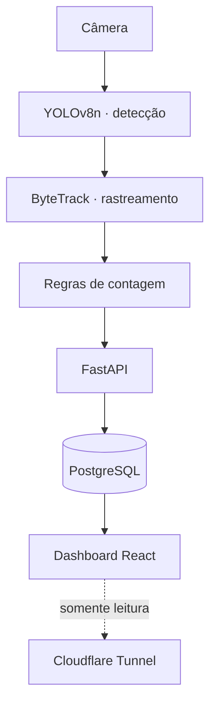

## Problema

A liderança da igreja queria saber quantas pessoas vinham a cada culto e como a ocupação variava ao
longo do tempo, para planejar espaço, equipe e horários. A contagem manual era imprecisa, dependia de
voluntário e não gerava histórico.

## Solução

Uma câmera na entrada alimenta um pipeline em Python que detecta pessoas com **YOLOv8n** e as acompanha
entre frames com **ByteTrack**. Cada pessoa vira um _track_ com identidade; a contagem acontece quando
o track cruza a linha de entrada ou saída — não quando aparece num frame.

Os eventos vão para **PostgreSQL** por uma API **FastAPI**, e um dashboard em **React + Vite + Recharts**
mostra ocupação ao vivo e histórico por culto.

Tudo roda **localmente**, num computador da própria igreja, como serviço `systemd`. Para ver o
dashboard de fora, um **Cloudflare Tunnel** expõe só a interface de leitura — nenhuma porta aberta no
roteador, nenhuma imagem sai do prédio e nenhum custo mensal de nuvem.

## Resultado

- Ocupação ao vivo e frequência por culto num painel, sem contagem manual
- Histórico que permite comparar cultos, meses e horários
- Operação 100% local: privacidade das imagens e custo de nuvem zero
- [TODO: precisão medida contra contagem manual, ex.: "erro de X% em N cultos"]

## Impacto

[TODO: decisão que a liderança tomou com base nos dados — ex.: ajuste de horário, equipe de recepção]

## Desafios técnicos

### Ocupação não é frequência

São duas métricas diferentes, e confundir as duas gera número errado. **Ocupação** é contínua:
entradas menos saídas, com reset noturno para não acumular erro de um dia para o outro. **Frequência**
é um _snapshot_ tirado durante o culto — quantas pessoas estavam presentes naquele momento. O sistema
calcula as duas separadamente.

### Não contar a mesma pessoa duas vezes

Quem para na porta, volta um passo ou passa na borda da câmera pode ser contado de novo. Quatro
mecanismos trabalham juntos:

1. **Zona morta** em volta da linha de contagem, onde oscilação não gera evento
2. **Cooldown por track**: o mesmo ID não conta de novo dentro de uma janela de tempo
3. **Limites de segmento**: só conta quem atravessa a linha dentro do trecho válido
4. **Lógica por tracking, não por frame**: a decisão olha a trajetória inteira do track

### Subcontagem conhecida, medida e registrada

Bebês no colo não são detectados como pessoas separadas. Em vez de "corrigir" o número com um fator
mágico, a subcontagem foi **medida e documentada** — quem lê o dashboard sabe exatamente qual é o viés.

## Aprendizados

- Em visão computacional, a regra de negócio em volta do modelo importa mais que o modelo.
- Um número honesto com viés conhecido vale mais que um número bonito sem explicação.
- Nem tudo precisa de nuvem: local + túnel resolveu privacidade, custo e acesso de uma vez.
