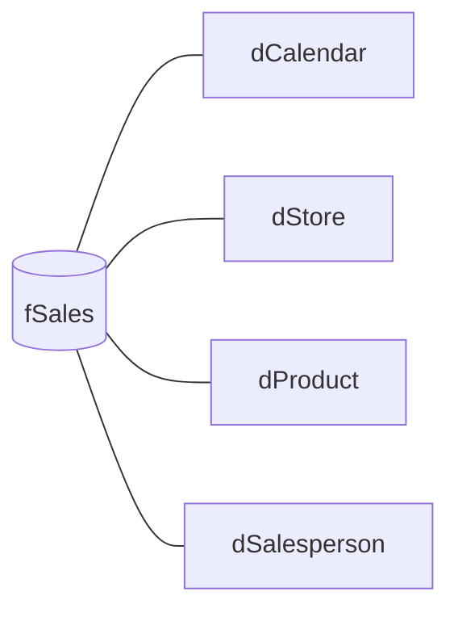

> Demo project: the data is fictional and does not belong to any company.

## Problem

A chain of stores tracks sales through spreadsheets exported from its system, one per month and per
store. Answering "which store dropped versus last year?" means stitching files together by hand, and
everyone ends up with a different number.

## Solution

A **Power BI** report with a single source of truth:

- **Power Query** merges the files, fixes data types and cleans inconsistent dates and codes
- **Star schema**: a sales fact table linked to Calendar, Store, Product and Salesperson dimensions
- **DAX measures** for revenue, average ticket, margin, year-over-year and year-to-date
- **Scheduled refresh** so the report stays current without manual work
- Three pages: overview, store performance and product analysis

## Result

- [TODO: screenshots of the 3 pages, with a caption for what each visual answers]
- [TODO: link to the published report or to the repository with the .pbix]

## Impact

[TODO: the business question the report answers in seconds]

## Technical challenges

### Comparing periods correctly

Year-over-year comparisons only work with a continuous Calendar table marked as a date table. Time
measures use that table instead of the sale date, so months with no sales don't vanish from charts.

## Learnings

- [TODO: what you learned building this report]
