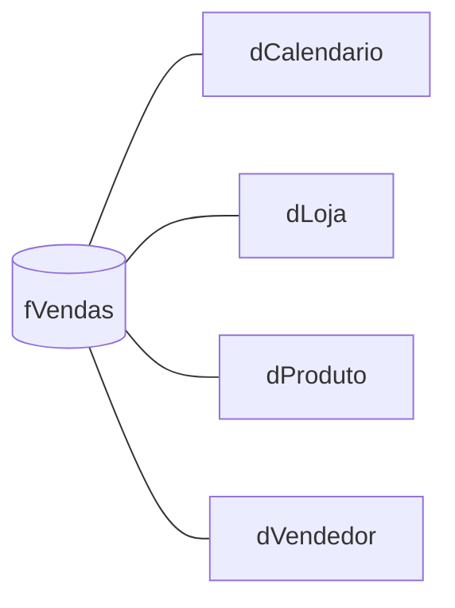

> Projeto demonstrativo: os dados são fictícios e não pertencem a nenhuma empresa.

## Problema

Uma rede de lojas acompanha vendas por planilhas exportadas do sistema, uma por mês e por loja.
Para responder "qual loja caiu em relação ao ano passado?" alguém precisa juntar arquivos à mão,
e cada pessoa chega a um número diferente.

## Solução

Um relatório em **Power BI** com uma única fonte da verdade:

- **Power Query** consolida os arquivos, padroniza tipos e trata datas e códigos inconsistentes
- **Modelo estrela**: fato de vendas ligada às dimensões Calendário, Loja, Produto e Vendedor
- **Medidas DAX** para receita, ticket médio, margem, comparação com o ano anterior e acumulado no ano
- **Atualização agendada** para o relatório se manter em dia sem intervenção
- Três páginas: visão geral, desempenho por loja e análise de produto

## Resultado

- [TODO: prints das 3 páginas, com legenda do que cada visual responde]
- [TODO: link do relatório publicado ou do repositório com o .pbix]

## Impacto

[TODO: a pergunta de negócio que o relatório responde em segundos]

## Desafios técnicos

### Comparar períodos sem erro

Comparações com o ano anterior só funcionam com uma tabela Calendário contínua e marcada como
tabela de datas. As medidas de tempo usam essa tabela, e não a data da venda, para que meses sem
venda não sumam do gráfico.

## Aprendizados

- [TODO: o que você aprendeu montando este relatório]
