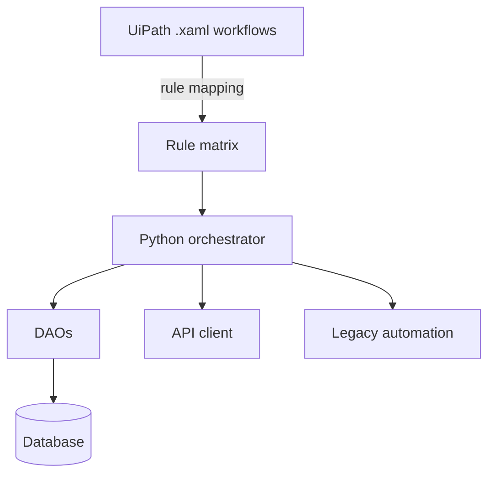

> Confidential project. Company, systems and processes are not identified.

## Problem

A credit-approval financial process relied on UiPath robots (`.xaml`) driving a legacy system. The visual
workflows were hard to version, review and test, and every change required the proprietary tool and
someone who knew the robot inside out.

## Solution

Migrate the robots to **object-oriented Python** with a layered architecture:

- **DAOs** isolating data access
- An **API client** for integrations that used to be visual steps
- A **legacy-system automation layer** wrapping screens and actions
- **Orchestration** reproducing the original workflow's sequence and decisions

The core requirement: **no business rule lost**. Every decision in the `.xaml` (condition, branch,
exception handling) was mapped and reproduced, and behavior was compared against the original robot.

## Result

- Workflows versioned in Git, reviewable as code and testable
- Behavior equivalent to the original robot, with no business rule lost
- [TODO: measurable result: processes migrated, runtime, failure rate]

## Impact

Maintenance no longer depends on a license or on knowledge held by a single person.
[TODO: confirmed impact]

## Technical challenges

### Business rules hidden in a visual flow

In `.xaml`, rules hide in properties, nested conditions and implicit error handling. The work started with
an **exhaustive mapping** of those decisions before writing any Python. The migration was treated as a
specification, not a translation.

### Automating a legacy system

Old systems don't expose an API for everything. The automation layer wraps those interactions so the
business logic doesn't depend on screen details.

## Lessons learned

- Migrating automation is, first of all, documenting rules nobody ever wrote down.
- Separating business rules from screen mechanics makes a robot testable.
