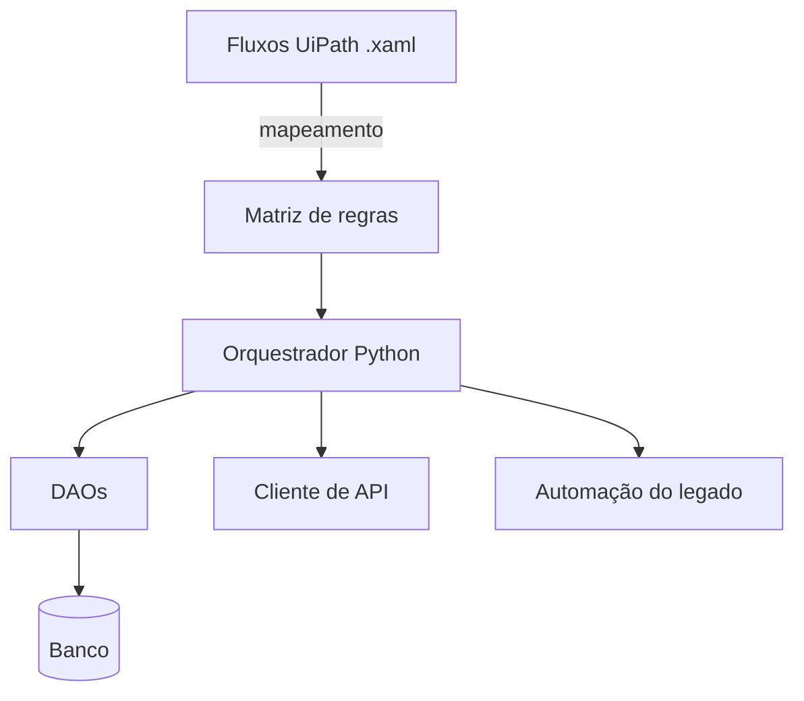

> Projeto confidencial. Empresa, sistemas e processos não são identificados.

## Problema

Um processo interno de uma instituição financeira dependia de robôs construídos em UiPath
(`.xaml`) operando um sistema legado. Os fluxos visuais eram difíceis de versionar, revisar e testar, e cada
ajuste exigia a ferramenta proprietária e alguém que conhecesse o robô a fundo.

## Solução

Migrar os robôs para **Python orientado a objetos**, com uma arquitetura em camadas:

- **DAOs** isolando o acesso a dados
- **Cliente de API** para as integrações que antes eram passos visuais
- **Camada de automação** do sistema legado, encapsulando telas e ações
- **Orquestração** que reproduz a sequência e as decisões do fluxo original

O requisito central: **zero perda de regra de negócio**. Cada decisão do `.xaml` (condição, desvio,
tratamento de exceção) foi mapeada e reproduzida, e o comportamento comparado com o do robô original.

## Resultado

- Fluxos versionados em Git, revisáveis como código e testáveis
- Comportamento equivalente ao robô original, sem perda de regra de negócio
- [TODO: resultado mensurável: nº de processos migrados, tempo de execução, falhas]

## Impacto

A manutenção deixa de depender de licença e de conhecimento concentrado numa pessoa.
[TODO: impacto confirmado]

## Desafios técnicos

### Regra de negócio escondida no fluxo visual

Em `.xaml`, regras ficam espalhadas em propriedades, condições aninhadas e tratamentos de erro
implícitos. O trabalho começou com um **mapeamento exaustivo** dessas decisões antes de escrever qualquer
linha de Python. A migração foi tratada como especificação, não como tradução.

### Automação de sistema legado

Sistemas antigos não têm API para tudo. A camada de automação encapsula essas interações para que a
lógica de negócio não dependa de detalhes de tela.

## Aprendizados

- Migrar automação é, antes de tudo, documentar regras que nunca foram escritas.
- Separar regra de negócio da mecânica de tela torna o robô testável.
