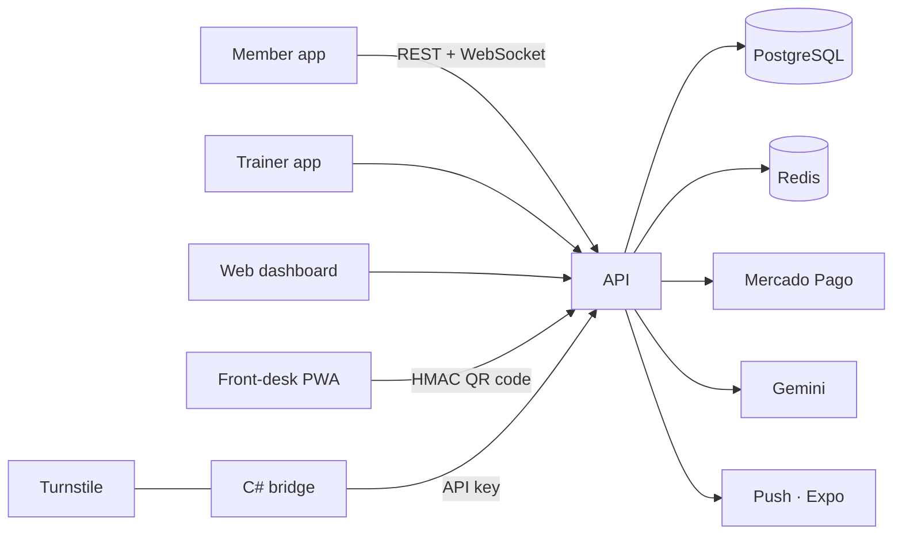

## Problem

Small gyms and independent personal trainers run members, monthly fees, workouts and door access
on a mix of spreadsheets, WhatsApp and paper. The outcome is predictable: late payments nobody
catches in time, members walking in with an expired plan, and trainers spending hours writing
workouts and meal plans by hand.

## Solution

A **multi-tenant** SaaS that covers the whole gym operation, split into six parts sharing one API:

- **API** in Node.js + Express + TypeScript, PostgreSQL through Prisma, Redis and Socket.io for real time
- **Web dashboard** (React + Vite + Tailwind) for gym owners and trainers
- **Member app** and **trainer app** in React Native + Expo
- **Front-desk PWA** running on a tablet at the entrance, scanning the member's QR code
- **C# bridge** for the physical turnstile, because the vendor SDK is a 32-bit Windows DLL that can't run on the Linux backend

Access uses a **QR code signed with a per-gym HMAC secret**: green when paid up, yellow when due
within 5 days, red when overdue. Billing runs on **Mercado Pago** (PIX, tokenized cards and
subscriptions), plus manual cash entries, with signature-verified webhooks.

**AI (Gemini)** builds meal plans through chat and suggests workout splits using only exercises
that match the equipment the gym actually owns. Nothing is published without the trainer's
approval — the AI suggests, the professional decides.

## Result

- In production at a gym with **100+ active members**
- 7-site skinfold body assessment with progress comparison and PDF export
- Digital contracts with **version history**: each signature stores the exact version the member read
- 12-month consolidated revenue and a "business health" view (churn, average ticket, LTV)
- CSV member import with row-by-row validation before committing
- Per-plan member limits enforced at all **5 places** a member can come into existence

## Impact

The gym owner now sees late payments and churn on a dashboard instead of finding out at month end,
and the front desk no longer depends on someone checking names on a spreadsheet. [TODO: impact
metric confirmed with the client — e.g. lower late-payment rate or hours saved per week]

## Technical challenges

### Tenant isolation in payment endpoints

During a security review I found payment endpoints that looked records up by `id` alone. An
authenticated user from one gym who knew the `id` of another gym's charge could read or modify data
that wasn't theirs (cross-tenant IDOR). The fix was enforcing `where: { id, tenantId }` on **every**
Prisma query and sweeping every route, with a security-audit test suite covering cross-gym access.

### Sensitive data and LGPD

Tax ID (CPF), phone and PIX keys are encrypted at rest with **AES-256-GCM**. To detect duplicate CPFs
without decrypting, I use a **blind index** (HMAC-SHA256). JWT with short-lived access tokens, persisted
refresh tokens with a unique `jti` and automatic rotation.

### Physical turnstile

The turnstile SDK only ships as a 32-bit Windows DLL. Instead of coupling the backend to it, the answer was a
C# program that runs on the front-desk PC, talks to the turnstile over TCP and calls the same validation
endpoint the QR code uses — a single source of truth for access rules.

## Lessons learned

- Multi-tenancy isn't a `tenantId` column: it's a discipline on every query, and it needs tests.
- AI in a product works better as a **reviewed suggestion** than as an automatic decision.
- Isolating legacy hardware behind a small bridge kept the core system simple.
