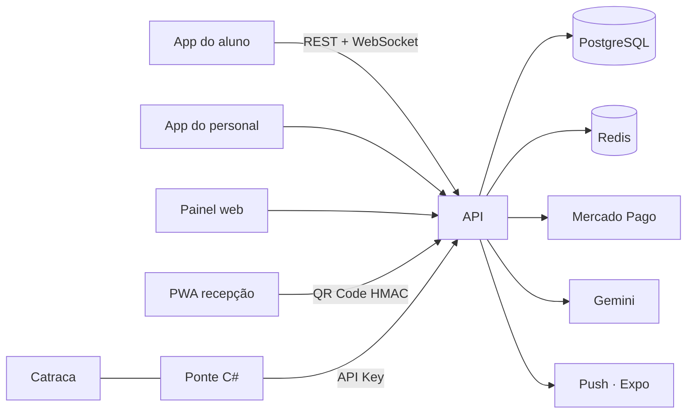

## Problema

Academias pequenas e personal trainers autônomos controlam alunos, mensalidades, treinos e
acesso na entrada com uma mistura de planilha, WhatsApp e caderno. O resultado é previsível:
inadimplência que ninguém percebe a tempo, aluno entrando com mensalidade vencida e o personal
gastando horas montando treino e dieta à mão.

## Solução

Um SaaS **multi-tenant** que cobre a operação inteira da academia, dividido em seis partes que
compartilham a mesma API:

- **API** em Node.js + Express + TypeScript, com PostgreSQL via Prisma, Redis e Socket.io para tempo real
- **Painel web** (React + Vite + Tailwind) para dono da academia e personais
- **App do aluno** e **app do personal** em React Native + Expo
- **PWA de recepção** rodando num tablet na entrada, lendo o QR Code do aluno
- **Ponte em C#** para a catraca física, porque a DLL do fabricante é Windows 32-bit e não roda no backend Linux

O acesso é por **QR Code assinado com HMAC por academia**: verde se em dia, amarelo se vence em até
5 dias, vermelho se vencido. A cobrança usa **Mercado Pago** (PIX, cartão tokenizado e assinatura),
com registro manual de pagamento em dinheiro e webhook verificado por assinatura.

A **IA (Gemini)** monta dieta por chat e sugere divisão de treino usando apenas os exercícios
compatíveis com o equipamento que a academia realmente tem. Nada é publicado sem a aprovação do
personal — a IA sugere, o profissional decide.

## Resultado

- Em produção numa academia com **100+ alunos ativos**
- Avaliação física Pollock 7 dobras com comparativo de evolução e exportação em PDF
- Contratos digitais com **histórico de versão**: a assinatura grava a versão exata que o aluno leu
- Faturamento consolidado de 12 meses e "saúde do negócio" (churn, ticket médio, LTV)
- Importação de alunos por CSV com validação linha a linha antes de confirmar
- Limite de alunos por plano aplicado nos **5 pontos** onde um aluno pode passar a existir

## Impacto

O dono da academia passou a ver inadimplência e churn num painel em vez de descobrir no fim do mês,
e a recepção deixou de depender de alguém conferindo nome em planilha. [TODO: métrica de impacto
confirmada com o cliente — ex.: redução de inadimplência ou tempo economizado por semana]

## Desafios técnicos

### Isolamento entre tenants em endpoints de pagamento

Numa revisão de segurança encontrei endpoints de pagamento que buscavam registros só pelo `id`.
Um usuário autenticado de uma academia, conhecendo o `id` de uma cobrança de outra, conseguiria
ler ou alterar dados que não eram dele (IDOR entre tenants). A correção foi adotar o padrão
`where: { id, tenantId }` em **todas** as consultas Prisma e fazer uma varredura completa das rotas,
com uma suíte de testes de auditoria cobrindo acesso cruzado entre academias.

### Dados sensíveis e LGPD

CPF, telefone e chave PIX são criptografados no banco com **AES-256-GCM**. Para checar CPF duplicado
sem descriptografar, uso um **índice cego** (HMAC-SHA256). JWT com access token curto, refresh token
persistido com `jti` e rotação automática.

### Catraca física

O SDK da catraca só existe como DLL Windows 32-bit. Em vez de acoplar o backend a isso, a solução foi um
programa em C# que roda no PC da recepção, conversa com a catraca por TCP e chama o mesmo endpoint de
validação que o QR Code usa — uma única fonte de regra de acesso.

## Aprendizados

- Multi-tenant não é um campo `tenantId` na tabela: é uma disciplina em toda consulta, e precisa de teste.
- IA em produto funciona melhor como **sugestão revisada** do que como decisão automática.
- Isolar o hardware legado atrás de uma ponte pequena manteve o núcleo do sistema simples.
