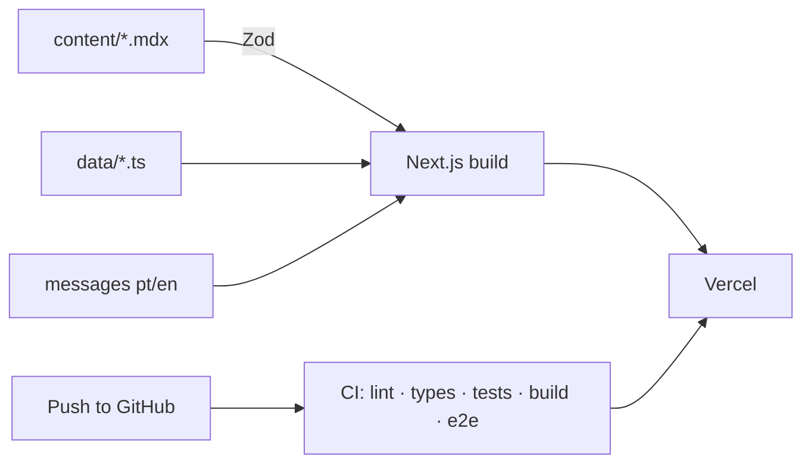

## Problem

Most of what I build is private code for clients or employers. Anyone who wanted to see how I write code
had nowhere to look. I needed a place that showed the projects and was, at the same time, a sample of my
code itself.

## Solution

A site built like a product, with an open repository:

- **Next.js 15** (App Router, static generation) with **strict TypeScript**
- **Portuguese and English** with `next-intl`: translated routes, `hreflang` and switching language on the same page
- **Content separate from code**: each case study is an MDX file validated with **Zod** at build time;
  experience and skills live in data files. Adding a project never touches a component
- **PDF résumé generated from the `/cv` page itself**, so it never drifts from the site
- **Technical SEO**: sitemap, JSON-LD, per-page Open Graph images
- **Contact form** with validation, a honeypot and rate limiting

## Result

- Lighthouse accessibility 100, also checked by automated axe tests
- Unit tests with Vitest and end-to-end tests with Playwright, on desktop and mobile
- A history of small, descriptive commits, one per change

## Impact

Recruiters and clients can open the repository and check in practice what the case studies claim:
structure, tests and attention to detail.

## Technical challenges

### Placeholders never reach production

While content is being written, fields are marked as pending. In development they are highlighted; in
production they disappear on their own, including the heading of a section left empty. A CI test reads
every generated page and fails if any placeholder slips through.

### Skills backed by proof

Each skill points to the project or job where it was used. If nothing on the site proves production use,
the displayed level drops automatically. The site can't claim more than it shows.

### Animation that never hides content

The server HTML is always visible. Animations only hide what is below the fold, and only after checking
that the visitor hasn't asked their system for reduced motion.

## Learnings

- Treating a portfolio as a product (tests, CI, review) gives it the same weight as client work.
- Rules written as tests last longer than rules written in a README.
