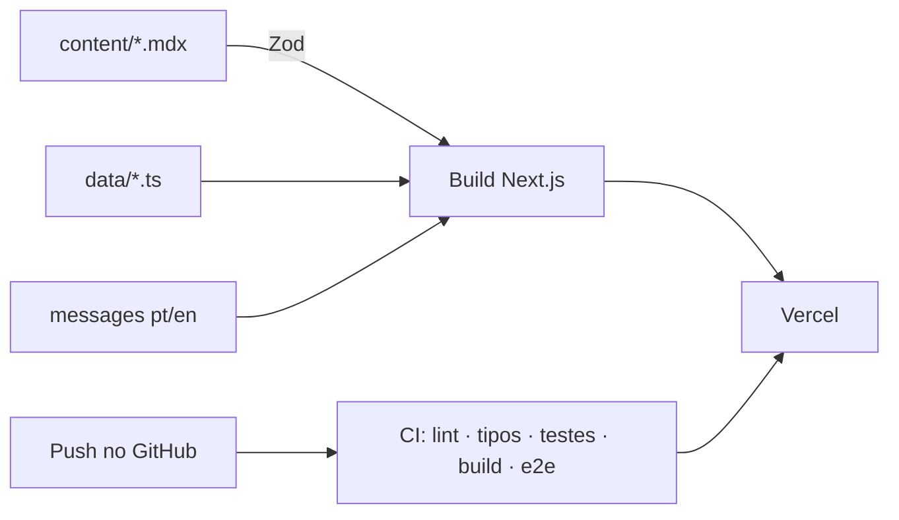

## Problema

A maior parte do que eu construo é código privado de cliente ou de empresa. Quem quer saber como eu
programo não tinha onde olhar. Eu precisava de um lugar que mostrasse os projetos e que, ao mesmo
tempo, fosse ele próprio uma amostra do meu código.

## Solução

Um site feito como produto, com o repositório aberto:

- **Next.js 15** (App Router, geração estática) com **TypeScript estrito**
- **Português e inglês** com `next-intl`: rotas traduzidas, `hreflang` e troca de idioma na mesma página
- **Conteúdo separado do código**: cada case é um arquivo MDX validado com **Zod** no build; experiência
  e habilidades ficam em arquivos de dados. Adicionar um projeto não exige mexer em componente
- **CV em PDF gerado da própria página `/cv`**, para nunca ficar diferente do site
- **SEO técnico**: sitemap, JSON-LD, Open Graph gerada por página
- **Formulário de contato** com validação, honeypot e limite de requisições

## Resultado

- Acessibilidade 100 no Lighthouse, verificada também por testes automáticos com axe
- Testes unitários com Vitest e testes de ponta a ponta com Playwright, em desktop e celular
- Histórico de commits pequenos e descritivos, um por mudança

## Impacto

Recrutadores e clientes podem abrir o repositório e conferir na prática o que os cases contam:
organização, testes e cuidado com o detalhe.

## Desafios técnicos

### Placeholder nunca vai para produção

Enquanto o conteúdo é escrito, campos ficam marcados como pendentes. Em desenvolvimento eles aparecem
destacados; em produção somem sozinhos, inclusive o título de uma seção que ficou vazia. Um teste no CI
lê todas as páginas geradas e falha se algum placeholder escapar.

### Habilidade com prova

Cada habilidade aponta para o projeto ou a experiência onde foi usada. Se nada no site comprova o uso em
produção, o nível exibido cai automaticamente. O site não consegue dizer mais do que mostra.

### Animação que não esconde conteúdo

O HTML do servidor sai sempre visível. As animações só escondem o que está abaixo da dobra, e só depois
de confirmar que a pessoa não pediu menos movimento no sistema.

## Aprendizados

- Tratar o portfólio como produto (testes, CI, revisão) dá a ele o mesmo valor de prova que um projeto de cliente.
- Regras escritas como teste duram mais do que regras escritas num README.
