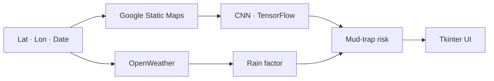

## Problem

In western Paraná, Brazil, much of the farm output travels on dirt roads. After heavy rain, stretches turn
into mud traps — stuck trucks, late loads, damaged machinery. There's no simple way to know, before leaving,
which stretches are at risk.

## Solution

A model that combines **what the road looks like** with **how much it will rain**:

- **Satellite images** fetched from the Google Static Maps API by coordinates — around 5,000 tiles of the
  Toledo-PR region
- A **TensorFlow/Keras CNN** trained to classify road condition from the image
- **Rain forecasts** from OpenWeather for the coordinate and date, turned into a wear factor
- A **Tkinter** interface where the user enters latitude, longitude and date and gets a prediction, running
  inference on a separate thread so the UI never freezes

## Result

- Full pipeline: image collection, training, inference and interface
- A custom satellite-image dataset of the region
- [TODO: model metric — accuracy / F1 on the test set]

## Impact

[TODO: grade, committee feedback or real-world use]

## Technical challenges

### Building the dataset

There's no public labeled dataset of "roads that get muddy". Collection was automated by coordinates, with
caching and execution logs, and labeling was done on top of that material.

### Combining image and weather

An image shows the road; it doesn't show tomorrow's rain. The final risk combines the CNN output with a wear
factor derived from forecast precipitation.

## Lessons learned

- In real problems, data work comes first — and takes longer — than the model.
- A simple interface turns a research script into something someone else can use.
