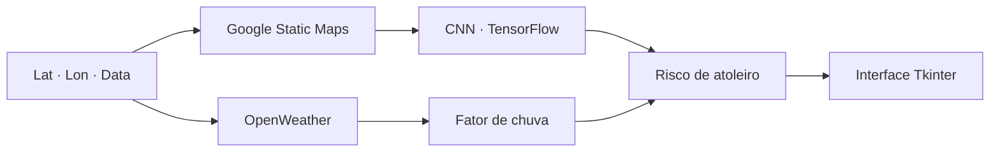

## Problema

No oeste do Paraná, boa parte do escoamento da produção agrícola passa por estradas de terra. Depois de
chuva forte, trechos viram atoleiro — caminhão parado, carga atrasada, máquina danificada. Não existe
um jeito simples de saber, antes de sair, quais trechos estão em risco.

## Solução

Um modelo que cruza **como a estrada é** com **quanto vai chover**:

- **Imagens de satélite** baixadas pela Google Static Maps API a partir de coordenadas — perto de
  5.000 recortes da região de Toledo-PR
- Uma **CNN em TensorFlow/Keras** treinada para classificar a condição do trecho a partir da imagem
- **Previsão de chuva** da OpenWeather para a coordenada e a data, transformada num fator de desgaste
- Uma interface em **Tkinter** onde o usuário informa latitude, longitude e data e recebe a previsão,
  com execução em _thread_ separada para não travar a tela

## Resultado

- Pipeline completo: coleta de imagens, treino, inferência e interface
- Base própria de imagens de satélite da região
- [TODO: métrica do modelo — acurácia / F1 no conjunto de teste]

## Impacto

[TODO: banca, nota ou aplicação prática]

## Desafios técnicos

### Montar o próprio dataset

Não existe base pública rotulada de "estrada que atola". A coleta foi automatizada por coordenadas, com
cache e log de execução, e a rotulagem feita sobre esse material.

### Juntar imagem e clima

Uma imagem mostra a estrada; não mostra a chuva de amanhã. O risco final combina a saída da CNN com um
fator de desgaste calculado a partir da precipitação prevista.

## Aprendizados

- Em problema real, o trabalho de dados vem antes — e dura mais — que o do modelo.
- Uma interface simples transforma um script de pesquisa em algo que outra pessoa consegue usar.
