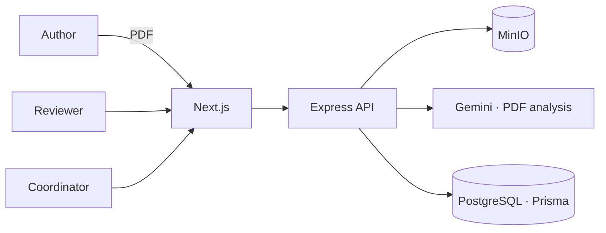

## Problem

Scientific events receive dozens of papers and depend on volunteer reviewers. The usual workflow is
email, spreadsheets and attached PDFs: nobody knows which stage each paper is in, versions get lost and
reviewers spend time on basic checks before they get to the content.

## Solution

At the hackathon we built a platform covering the whole cycle: event, submission, paper versions,
reviewer assignment, per-event checklists, comments and final review.

My main front was the **AI integration**: every uploaded PDF is stored in **MinIO** and analyzed by
**Gemini**, which produces a first read to support the reviewer — the decision stays human. I also worked
on the upload pipeline (watched folder → MinIO → analysis) and refactored controllers and services.

After the hackathon, the same team grew the project into **Submita**: a layered backend
(application · infrastructure · presentation), **author, reviewer and coordinator** roles, and a new
Next.js frontend with Zod-validated forms.

## Result

- End-to-end submission and review flow working at the hackathon
- Automatic PDF analysis supporting reviewers
- Grown into a product with a layered architecture and a rewritten frontend
- [TODO: hackathon placement / award, if any]

## Impact

[TODO: event where it was used, number of papers or reviewers — if any]

## Technical challenges

### AI as support, not as judge

Scientific review can't be outsourced to a model. Gemini's analysis is attached to the paper as a
**first read**, and the verdict stays with the reviewer.

### Large files out of the database

PDFs live in **MinIO** (S3-compatible) and the database keeps only metadata and versions. That keeps
PostgreSQL lean and makes swapping storage easy later.

## Lessons learned

- At a hackathon, cutting scope early beats coding fast.
- Turning a prototype into a product means rebuilding the foundation — and that's fine.
