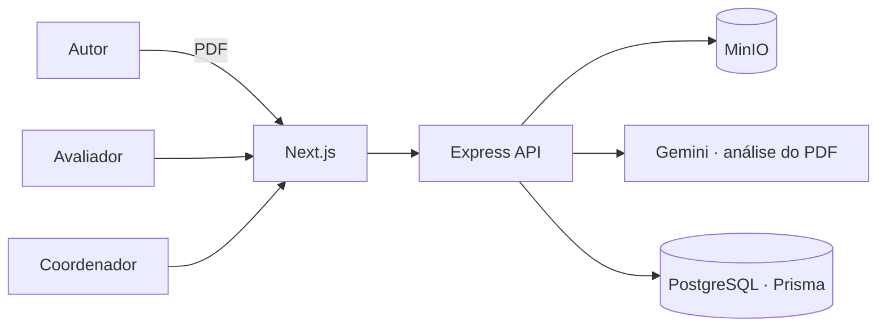

## Problema

Eventos científicos recebem dezenas de artigos e dependem de avaliadores voluntários. O fluxo costuma
ser e-mail, planilha e PDF anexado: ninguém sabe em que etapa cada artigo está, versões se perdem e o
avaliador gasta tempo com checagens básicas antes de chegar ao conteúdo.

## Solução

No hackathon, construímos uma plataforma com o ciclo completo: evento, submissão, versões do artigo,
distribuição para avaliadores, checklist por evento, comentários e parecer.

Minha frente principal foi a **integração com IA**: cada PDF enviado é armazenado no **MinIO** e
analisado pelo **Gemini**, que gera uma leitura prévia para apoiar o avaliador. A decisão continua
sendo humana. Também trabalhei no pipeline de upload (pasta observada → MinIO → análise) e em
refatorações de controllers e services.

Depois do hackathon, o mesmo time evoluiu o projeto para o **Submita**: backend em camadas
(application · infrastructure · presentation), perfis **autor, avaliador e coordenador**, e um
frontend novo em Next.js com formulários validados por Zod.

## Resultado

- Fluxo completo de submissão e avaliação funcionando ponta a ponta no hackathon
- Análise automática de PDF como apoio ao avaliador
- Evolução para produto com arquitetura em camadas e frontend reescrito
- [TODO: colocação no hackathon / premiação, se houver]

## Impacto

[TODO: evento em que foi usado, nº de artigos ou avaliadores, se houver]

## Desafios técnicos

### IA como apoio, não como juiz

Avaliação científica não pode ser terceirizada para um modelo. A análise do Gemini entra como
**leitura prévia** anexada ao artigo, e o parecer continua sendo do avaliador.

### Arquivos grandes fora do banco

PDFs ficam no **MinIO** (compatível com S3), e o banco guarda só metadados e versões. Isso mantém o
PostgreSQL leve e facilita trocar o storage depois.

## Aprendizados

- Num hackathon, cortar escopo cedo vale mais que codar rápido.
- Transformar protótipo em produto exige reescrever a fundação, e tudo bem.
